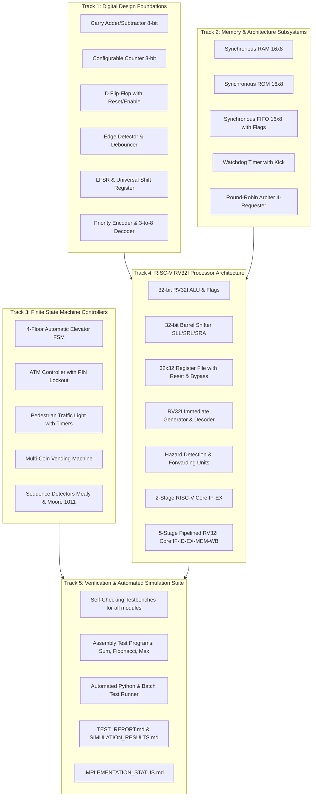

# Implementation Roadmap: RISC-V & Digital Design Upgrade

## 1. Upgrade Strategy

The upgrade is executed systematically in 5 sequential tracks to ensure modularity, zero breaking changes to existing files, synthesizability, and 100% verification coverage:



---

## 2. Directory Layout & File Organization

To keep the repository clean and professional without breaking existing paths:

```text
├── 4bit_half_adder/                # Existing legacy exercise (preserved)
├── project/                        # Existing legacy ALU project (preserved)
├── docs/                           # Existing and expanded documentation
│   └── source-review.md
├── rtl/
│   ├── alu_4bit.v                  # Existing verified 4-bit ALU (preserved)
│   ├── registered_adder_4bit.v     # Existing verified registered adder (preserved)
│   ├── ripple_adder_4bit.v         # Existing verified ripple adder (preserved)
│   ├── wash_controller.v           # Existing verified washing machine FSM (preserved)
│   │
│   ├── digital_design/             # [NEW] Foundational digital design building blocks
│   │   ├── carry_adder_subtractor_8bit.v
│   │   ├── configurable_counter_8bit.v
│   │   ├── d_flip_flop.v
│   │   ├── edge_detector.v
│   │   ├── button_debouncer.v
│   │   ├── lfsr_8bit.v
│   │   ├── universal_shift_register_8bit.v
│   │   ├── priority_encoder_8to3.v
│   │   └── decoder_3to8.v
│   │
│   ├── memory/                     # [NEW] Memory and arbiter modules
│   │   ├── sync_ram_16x8.v
│   │   ├── sync_rom_16x8.v
│   │   ├── sync_fifo_16x8.v
│   │   ├── watchdog_timer.v
│   │   └── round_robin_arbiter_4req.v
│   │
│   ├── fsm/                        # [NEW] Advanced FSM controller applications
│   │   ├── elevator_controller.v
│   │   ├── atm_controller.v
│   │   ├── pedestrian_traffic_light.v
│   │   ├── vending_machine.v
│   │   ├── sequence_detector_mealy.v
│   │   └── sequence_detector_moore.v
│   │
│   └── riscv/                      # [NEW] Complete RISC-V RV32I Processor Subsystem
│       ├── riscv_alu.v             # 32-bit RV32I ALU
│       ├── riscv_barrel_shifter.v  # 32-bit barrel shifter
│       ├── riscv_regfile.v         # 32x32 register file with sync reset & bypass
│       ├── riscv_imm_gen.v         # RV32I immediate generator (I, S, B, U, J)
│       ├── riscv_control.v         # Complete RV32I control and decode unit
│       ├── riscv_hazard_unit.v     # Hazard detection, forwarding, and stall unit
│       ├── riscv_core_2stage.v     # 2-stage educational RISC-V CPU
│       └── riscv_core_5stage.v     # 5-stage pipelined RV32I CPU with forwarding
│
├── tb/                             # Self-checking testbenches
│   ├── tb_alu_4bit.v               # Existing (preserved)
│   ├── tb_registered_adder_4bit.v  # Existing (preserved)
│   ├── tb_ripple_adder_4bit.v      # Existing (preserved)
│   ├── tb_wash_controller.v        # Existing (preserved)
│   │
│   ├── digital_design/             # [NEW] Testbenches for digital design blocks
│   ├── memory/                     # [NEW] Testbenches for memory/arbiter
│   ├── fsm/                        # [NEW] Testbenches for FSMs
│   └── riscv/                      # [NEW] Testbenches for RISC-V cores & programs
│
├── programs/                       # [NEW] RV32I Assembly Benchmark Programs & HEX
│   ├── program1_sum.hex
│   ├── program2_fibonacci.hex
│   ├── program3_max.hex
│   └── programs_assembly.md
│
├── scripts/                        # [NEW] Build, simulation, and verification scripts
│   ├── verify.py                   # Automated regression simulation engine
│   └── run_all_sims.bat            # Batch simulator script for Icarus / ModelSim
│
├── PROJECT_AUDIT.md                # [NEW] Complete existing project audit
├── REFERENCE_COMPARISON.md         # [NEW] Detailed reference gap analysis
├── IMPLEMENTATION_ROADMAP.md       # [NEW] Architecture & roadmap plan
├── IMPLEMENTATION_STATUS.md        # [NEW] Real-time component tracking
├── TEST_REPORT.md                  # [NEW] Comprehensive verification results
├── SIMULATION_RESULTS.md           # [NEW] Actual simulation test logs & evidence
└── README.md                       # [UPGRADED] Professional documentation
```

---

## 3. Milestones and Priority Schedule

- **Milestone 1 (P1)**: Foundational Digital Design Modules & Testbenches.
- **Milestone 2 (P1)**: Memory & Architecture Modules (RAM, ROM, FIFO, Arbiter, Watchdog) & Testbenches.
- **Milestone 3 (P1)**: FSM Controllers (Elevator, ATM, Traffic, Vending, Sequence Detectors) & Testbenches.
- **Milestone 4 (P0)**: RV32I Datapath & Processor Cores (ALU, Barrel Shifter, Regfile, ImmGen, Hazard/Forwarding, 2-Stage, 5-Stage Pipelined Core) & Assembly Programs.
- **Milestone 5 (P0)**: Verification Suite Execution, Bug Investigation & Resolution, Regression Closure.
- **Milestone 6 (P0)**: Documentation, Architecture Diagrams, and Deliverables.
