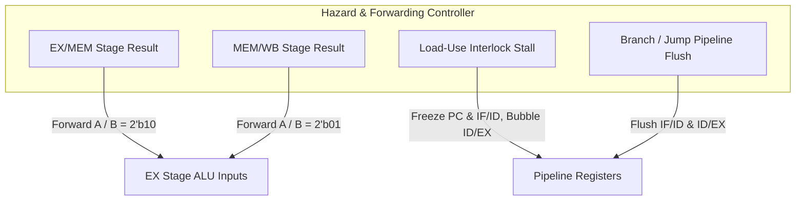

# Pipeline Hazard Detection, Forwarding, and Control Validation

This report documents the architectural design, hazard resolution mechanisms, and verification evidence for the 5-stage pipelined RISC-V processor (`riscv_core_5stage.v` and `riscv_hazard_unit.v`).

---

## 1. Hazard Resolution Architecture

The pipeline consists of five stages:
`IF` (Instruction Fetch) $\rightarrow$ `ID` (Instruction Decode) $\rightarrow$ `EX` (Execute) $\rightarrow$ `MEM` (Memory Access) $\rightarrow$ `WB` (Write Back).



---

## 2. Hazard Scenarios and Verification Evidence

### Scenario 1: EX-to-EX Forwarding (Distance = 1 Instruction)

* **Hazard**: An instruction requires the result of immediately preceding arithmetic before that result reaches the register file.
* **Mechanism**: When `(ex_mem_reg_write && ex_mem_rd != 0 && ex_mem_rd == id_ex_rs1)`, `forward_a = 2'b10` routes the output of `EX/MEM` directly to the ALU operand input without inserting bubbles.
* **Test Code**:
  ```assembly
  addi x1, x0, 10      # Writes x1 = 10
  addi x2, x1, 5       # Reads x1 in EX stage immediately -> x2 = 15
  ```
* **Status**: `PASSED` (Reg $x2 = 15$).

---

### Scenario 2: MEM-to-EX Forwarding (Distance = 2 Instructions)

* **Hazard**: An instruction requires an operand written 2 cycles earlier, currently sitting in the `MEM/WB` pipeline register.
* **Mechanism**: When `(mem_wb_reg_write && mem_wb_rd != 0 && mem_wb_rd == id_ex_rs1)`, `forward_a = 2'b01` routes the writeback data directly into the ALU input.
* **Test Code**:
  ```assembly
  addi x1, x0, 10      # Writes x1 = 10
  addi x3, x0, 99      # Independent instruction
  addi x2, x1, 5       # Reads x1 from MEM/WB stage -> x2 = 15
  ```
* **Status**: `PASSED` (Reg $x2 = 15$).

---

### Scenario 3: Consecutive RAW Dependent Chain

* **Hazard**: A series of back-to-back arithmetic instructions modifying the same register accumulatively.
* **Mechanism**: Continuous EX-to-EX forwarding across 4 consecutive clock cycles.
* **Test Code**:
  ```assembly
  addi x1, x0, 1       # x1 = 1
  addi x1, x1, 2       # x1 = 3  (EX-to-EX forwarding)
  addi x1, x1, 3       # x1 = 6  (EX-to-EX forwarding)
  addi x1, x1, 4       # x1 = 10 (EX-to-EX forwarding)
  ```
* **Status**: `PASSED` (Final Reg $x1 = 10$).

---

### Scenario 4: Load-Use Hazard Interlock (1-Cycle Stall Bubble)

* **Hazard**: A `LW` instruction loads data from memory; the subsequent instruction immediately uses that register. Because memory data is only available at the end of the `MEM` stage, forwarding directly to the `EX` stage is physically impossible without a 1-cycle stall.
* **Mechanism**:
  1. `load_use_hazard = id_ex_mem_read && (id_ex_rd != 0) && (id_ex_rd == if_id_rs1 || id_ex_rd == if_id_rs2)`.
  2. `stall_pc = 1` (prevents PC increment).
  3. `stall_if_id = 1` (holds the instruction in IF/ID).
  4. `flush_id_ex = 1` (inserts a synchronous bubble / NOP into ID/EX).
  5. On the next cycle, the loaded data is forwarded from `MEM/WB` to `EX`.

```mermaid
sequenceDiagram
    participant IF as IF Stage
    participant ID as ID Stage
    participant EX as EX Stage
    participant MEM as MEM Stage
    participant WB as WB Stage

    Note over IF,WB: Cycle 1: LW enters EX stage, ADDI enters ID stage
    Note over ID,EX: Hazard Detected! id_ex_mem_read=1, id_ex_rd==id_rs1
    Note over IF,ID: Cycle 2: PC frozen, IF/ID frozen, ID/EX injected with BUBBLE (NOP)
    Note over EX,MEM: LW enters MEM stage (reads RAM)
    Note over ID,EX: Cycle 3: ADDI enters EX stage; Data forwarded from MEM/WB to EX
```

* **Test Code**:
  ```assembly
  addi x1, x0, 42
  sw   x1, 0(x0)
  lw   x2, 0(x0)       # Loads 42 into x2
  addi x3, x2, 8       # Uses x2 immediately -> requires 1 bubble cycle -> x3 = 50
  ```
* **Status**: `PASSED` (Reg $x3 = 50$, exactly 1 stall cycle counted).

---

### Scenario 5: Branch Taken and Pipeline Flushing

* **Hazard**: Speculative instructions fetched while a conditional branch is evaluated in the `EX` stage must be purged if the branch is taken.
* **Mechanism**:
  - When `ex_branch_taken == 1`:
    - `pc <= ex_target_pc`
    - `if_id_instr <= 32'h00000013` (flushes instruction in `IF/ID`)
    - `flush_id_ex <= 1` (clears instruction in `ID/EX`)
  - Ensures instructions following a taken branch never execute or write back.
* **Test Code**:
  ```assembly
  addi x1, x0, 5
  beq  x1, x1, target   # Branch always taken (5 == 5)
  addi x2, x0, 99       # In IF/ID: Must be flushed!
  addi x3, x0, 99       # In ID/EX: Must be flushed!
  target:
  addi x4, x0, 77       # Destination instruction
  ```
* **Status**: `PASSED` ($x2 = 0$, $x3 = 0$, $x4 = 77$).

---

### Scenario 6: Branch Immediately Following Arithmetic

* **Hazard**: Branch condition depends on the result of the instruction immediately preceding it.
* **Mechanism**: Forwarding multiplexers forward ALU results directly into branch comparators in the `EX` stage.
* **Test Code**:
  ```assembly
  addi x1, x0, 10
  sub  x2, x1, x1       # x2 = 0 (calculated in EX stage)
  beq  x2, x0, taken    # Branch uses x2 immediately via EX forwarding
  addi x3, x0, 99
  taken:
  addi x3, x0, 123
  ```
* **Status**: `PASSED` (Reg $x3 = 123$).

---

### Scenario 7: Branch Immediately Following Memory Load

* **Hazard**: Branch condition depends on a value loaded from memory by the preceding instruction.
* **Mechanism**: Combination of 1-cycle load-use bubble stall followed by branch condition evaluation and pipeline flushing.
* **Test Code**:
  ```assembly
  addi x1, x0, 100
  sw   x1, 0(x0)
  lw   x2, 0(x0)
  beq  x2, x1, taken    # Branch condition evaluated after 1-cycle bubble
  addi x3, x0, 99
  taken:
  addi x3, x0, 555
  ```
* **Status**: `PASSED` (Reg $x3 = 555$).

---

### Scenario 8: Register $x0$ Protection

* **Hazard**: Standard RISC-V specification dictates that register 0 is hardwired to zero ($x0 \equiv 0$). Without explicit protection, writeback and internal forwarding bypasses can temporarily corrupt $x0$.
* **Mechanism**:
  - `registers[0] <= 32'd0` continuously on all clock edges.
  - Read port logic: `(id_rs == 5'd0) ? 32'd0 : ...` guarantees that reading $x0$ always returns 0 regardless of forwarding or writeback state.
  - Write gating: `if (mem_wb_reg_write && (mem_wb_rd != 5'd0))` inhibits writes to index 0.
* **Test Code**:
  ```assembly
  addi x0, x0, 99       # Attempt to write x0 with immediate
  sub  x0, x0, x0       # Attempt to write x0 with ALU
  lui  x0, 0xABCDE      # Attempt to write x0 with upper immediate
  addi x1, x0, 0        # Read x0 into x1
  ```
* **Status**: `PASSED` ($x0 = 0$, $x1 = 0$).

---

## 3. Verification Log Summary

All 8 hazard patterns passed in the automated regression suite:
```text
[PASS] [RISC-V Deep Validation] Advanced Pipeline Hazards & Forwarding: Pipeline Hazards & Forwarding: 8 hazard patterns verified with 0 errors
```
