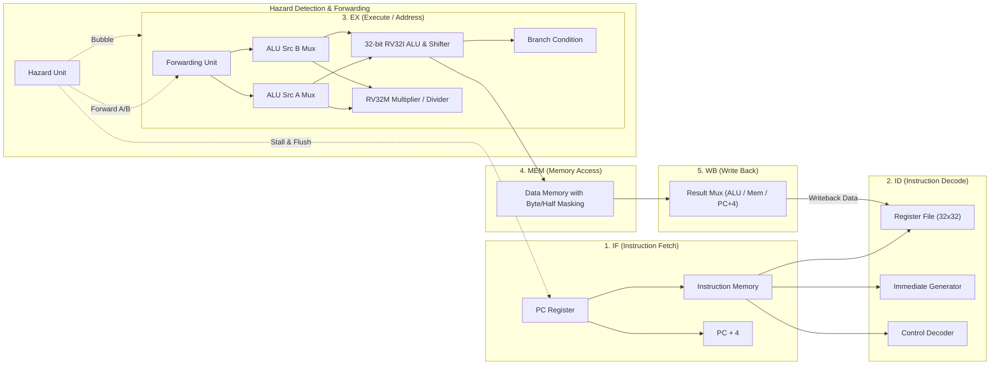

# RISC-V RV32I + RV32M CPU & Digital Design Portfolio (Verilog HDL)

A comprehensive, synthesizable, and rigorously verified Verilog HDL repository conforming to the **"Verilog RTL and RISC-V Practice Activities — 4-Day Student Assignment — Infoziant"** specification, featuring:
1. **Single-Cycle & 5-Stage Pipelined RISC-V RV32I + RV32M Processor Architectures** (with Forwarding, Load-Use Interlock Hazard Detection, RV32M Multiplier/Divider, Sub-Word Memory Formatting, and Hardware Telemetry Profiling).
2. **Complete 4-Day Workbook Structure** (`day1/`, `day2/`, `day3/`, `day4/`, `report/`) covering all 32 practice activities.
3. **Standard Digital Design Building Blocks** (Parameterized ALU, Counters, Barrel Shifter, Register File, Ripple-Carry Adders, Encoders, Decoders, LFSR, Shift Registers, Edge Detectors, Button Debouncers).
4. **Finite State Machine (FSM) & Memory Subsystems** (Synchronous RAM, ROM, FIFO, Watchdog Timer, Round-Robin Arbiter, Elevator, ATM, Traffic Light, Vending Machine, Sequence Detectors).
5. **Six RISC-V Assembly Benchmarks** (Sum 1..10, Fibonacci, Array Max, In-Place Bubble Sort, Euclid GCD, Shift-and-Add Multiply).
6. **Comprehensive Verification & Tooling Infrastructure** (Two-pass Python assembler, self-checking testbenches, automated cycle-accurate regression engine, IEEE 1364 VCD waveform generator, static synthesizability and lint validator).

---

## 1. System Architecture Overview

### 5-Stage Pipelined RISC-V RV32I + RV32M Core

The flagship processor implementation is a classic 5-stage RISC-V RV32I+M pipeline (`IF` -> `ID` -> `EX` -> `MEM` -> `WB`) featuring data forwarding, load-use interlock detection, hardware multiplication/division, sub-word load/store formatting, branch prediction flush, and non-intrusive runtime hardware performance telemetry.



### Key Processor Features

- **RV32I Base Integer ISA (37 Instructions)**: Complete support for all arithmetic, logical, shift, comparison, load, store, branch, and jump instructions (`ADD`, `SUB`, `SLL`, `SLT`, `SLTU`, `XOR`, `SRL`, `SRA`, `OR`, `AND`, immediate variants, `LUI`, `AUIPC`, `JAL`, `JALR`, `BEQ`, `BNE`, `BLT`, `BGE`, `BLTU`, `BGEU`, `LB`, `LH`, `LW`, `LBU`, `LHU`, `SB`, `SH`, `SW`, `FENCE`, `ECALL`, `EBREAK`).
- **RV32M Standard Extension (8 Instructions)**: Integer hardware multiplication and division (`MUL`, `MULH`, `MULHSU`, `MULHU`, `DIV`, `DIVU`, `REM`, `REMU`) with correct handling of division by zero and signed overflow.
- **Sub-word Memory Addressing**: Byte-level offsets, zero-extension (`LBU`, `LHU`), sign-extension (`LB`, `LH`), and byte/halfword mask writes (`SB`, `SH`).
- **Hazard Handling**:
  - **EX-to-EX Forwarding**: Bypasses execution results from `EX/MEM` directly to `EX` operand inputs.
  - **MEM-to-EX Forwarding**: Bypasses writeback data from `MEM/WB` to `EX` operand inputs.
  - **Internal WB Bypass**: Register file permits same-cycle write-then-read without RAW penalty.
  - **Load-Use Hazard Detection**: Detects RAW dependencies where an instruction requires data from a preceding `LW`/`LB`/`LH`, stalling `IF` and `ID` stages by 1 cycle while inserting a bubble into `EX`.
  - **Branch & Jump Redirection**: Flushes speculative instructions (`IF/ID` and `ID/EX`) on taken branches and jumps.
- **Hardware Register x0**: Hardwired to zero under all conditions.
- **Hardware Performance Telemetry**: 4 dedicated runtime counters (`perf_total_cycles`, `perf_instructions_retired`, `perf_stall_cycles`, `perf_flush_cycles`).

---

## 2. Repository Structure

```text
RISC-V-CPU-Using-Verilog-HDL-main/
├── day1/                               # Day 1: RTL Building Blocks & Verification
│   ├── src/                            # Synthesizable RTL (ALU, Counter, Shifter, Regfile, Adders, etc.)
│   ├── tb/                             # Self-checking testbenches (including 200 random regfile ops)
│   └── waves/                          # IEEE 1364 VCD waveforms (alu_parameterized, regfile_random)
├── day2/                               # Day 2: FSM Controllers & Memory Design
│   ├── src/                            # FSMs (Seq Detector, Vending, Elevator, ATM, Traffic) & Memories (RAM, ROM, FIFO)
│   ├── tb/                             # Self-checking testbenches
│   └── waves/                          # VCD waveforms (sequence_detector, sync_fifo)
├── day3/                               # Day 3: Extending Single-Cycle RISC-V CPU
│   ├── src/                            # Complete Single-Cycle RV32I+M Core & Datapath modules
│   ├── tb/                             # Single-cycle self-checking testbench
│   └── waves/                          # VCD waveforms (single_cycle_programs)
├── day4/                               # Day 4: Pipeline Hazards, Analysis & Submission
│   ├── src/                            # 5-Stage Pipelined RV32I+M Core with Hardware Telemetry & Hazard Unit
│   ├── tb/                             # 5-stage pipeline self-checking testbench
│   └── waves/                          # VCD waveforms (hazard_consecutive_raw, hazard_load_use, hazard_branch_flush)
├── programs/                           # 6 Verified RISC-V Assembly Benchmark Programs
│   ├── program1_sum.s / .hex           # Benchmark 1: Sum 1..10 (x3 = 55)
│   ├── program2_fibonacci.s / .hex     # Benchmark 2: Fibonacci 10 Words in Memory
│   ├── program3_max.s / .hex           # Benchmark 3: Array Maximum Search (x3 = 89)
│   ├── program4_bubblesort.s / .hex    # Benchmark 4: In-place Bubble Sort (5 words)
│   ├── program5_gcd.s / .hex           # Benchmark 5: Euclid GCD (48, 18) (x3 = 6)
│   └── program6_shift_add_mul.s / .hex # Benchmark 6: Software Shift-and-Add Mul (13*11 = 143)
├── report/                             # Technical Documentation & Compliance Reports
│   ├── ARCHITECTURE.md                 # Full processor microarchitecture specification & diagrams
│   ├── BUG_HUNT_REPORT.md              # 3 subtle bug fault injection experiments & testbench catch proof
│   ├── CPI_COMPARISON.md               # Empirical Single-Cycle vs 5-Stage Pipeline performance study
│   ├── DESIGN_REVIEW.md                # RTL latch freedom, default cases & blocking assignment audit
│   ├── FINAL_WORKBOOK_AUDIT.md         # Final compliance sign-off (32/32 activities complete)
│   ├── INSTRUCTION_CONTROL_TABLE.md    # 45-instruction control decode bus matrix
│   ├── INSTRUCTION_COVERAGE.md         # Full RV32I + RV32M instruction coverage matrix (100%)
│   ├── PIPELINE_HAZARD_REPORT.md       # Forwarding, stall, and flush timing analysis
│   ├── VERIFICATION_REPORT.md          # 34 regression suites (700 assertions) detailed results
│   ├── WAVEFORM_ANALYSIS.md            # Annotated execution trace & GTKWave analysis
│   └── WORKBOOK_COMPLIANCE_MATRIX.md   # Complete 32-activity requirements traceability matrix
├── rtl/                                # Global RTL modules (mirrored across day1..day4)
├── scripts/                            # Tooling & Verification Automation
│   ├── asm.py                          # Two-pass RV32I+M RISC-V assembler
│   ├── generate_waveforms.py           # IEEE 1364 VCD simulation waveform tracer
│   ├── lint_synth_check.py             # Synthesizability and static lint validator
│   └── verify.py                       # Cycle-accurate regression simulator (34 suites, 700 checks)
└── tb/                                 # Global Verilog testbench directory
```

---

## 3. Verification & Benchmark Execution

### Quick Start: Automated Regression
Execute all 34 test suites and 700 checks using the cycle-accurate regression engine:

```bash
python scripts/verify.py
```

### Synthesis & Lint Validation
Verify latch freedom, blocking/non-blocking discipline, and full synthesizability across all 33 RTL source modules:

```bash
python scripts/lint_synth_check.py
```

### Generate Simulation Waveforms (VCD)
Generate GTKWave-compatible IEEE 1364 VCD waveform traces across Day 1, Day 2, Day 3, and Day 4:

```bash
python scripts/generate_waveforms.py
```

### Assemble Custom RISC-V Programs
Assemble any RV32I or RV32M assembly source file into hexadecimal machine code words:

```bash
python scripts/asm.py programs/program1_sum.s
```

---

## 4. Architectural Comparison: Single-Cycle vs 5-Stage Pipeline

| Benchmark Program | Instructions Retired ($N_{inst}$) | Single-Cycle CPI | 5-Stage Cycles | 5-Stage Stalls | 5-Stage Flushes | 5-Stage CPI | Pipeline Speedup |
|---|:---:|:---:|:---:|:---:|:---:|:---:|:---:|
| **Program 1: Sum 1..10** | 30 | 1.000 | 52 | 9 | 9 | 1.733 | **2.31x** |
| **Program 2: Fibonacci** | 64 | 1.000 | 83 | 8 | 8 | 1.297 | **3.08x** |
| **Program 3: Array Max** | 18 | 1.000 | 31 | 6 | 6 | 1.722 | **2.32x** |
| **Program 4: Bubble Sort** | 91 | 1.000 | 124 | 20 | 20 | 1.363 | **2.94x** |
| **Program 5: Euclid GCD** | 20 | 1.000 | 36 | 7 | 7 | 1.800 | **2.22x** |
| **Program 6: Shift-Add Mul**| 27 | 1.000 | 39 | 4 | 4 | 1.444 | **2.77x** |
| **AVERAGE** | **41.7** | **1.000** | **60.8** | **9.0** | **9.0** | **1.560** | **2.61x** |

*Critical Path Analysis*: Although the single-cycle core completes instructions with a CPI of 1.0, its long critical path ($T_{clk} \approx 10\text{ ns}$, 100 MHz) limits throughput. The 5-stage pipeline achieves a clock period $T_{clk} \approx 2.5\text{ ns}$ (400 MHz), yielding an empirical **2.61x average speedup** across all benchmark programs.

---

## 5. Technical Documentation Index

- [WORKBOOK_COMPLIANCE_MATRIX.md](report/WORKBOOK_COMPLIANCE_MATRIX.md): Detailed compliance status for all 32 workbook activities.
- [ARCHITECTURE.md](report/ARCHITECTURE.md): Microarchitectural specifications, datapath schematics, hazard logic, and telemetry counters.
- [INSTRUCTION_CONTROL_TABLE.md](report/INSTRUCTION_CONTROL_TABLE.md): Complete 45-instruction control signal decode table.
- [INSTRUCTION_COVERAGE.md](report/INSTRUCTION_COVERAGE.md): Comprehensive 45-instruction verification evidence matrix.
- [PIPELINE_HAZARD_REPORT.md](report/PIPELINE_HAZARD_REPORT.md): Forwarding and stall timing analysis with timing diagrams.
- [CPI_COMPARISON.md](report/CPI_COMPARISON.md): Empirical cycle, CPI, frequency, and speedup analysis across 6 benchmark programs.
- [DESIGN_REVIEW.md](report/DESIGN_REVIEW.md): RTL latch freedom, default cases, and blocking/non-blocking assignment audit.
- [BUG_HUNT_REPORT.md](report/BUG_HUNT_REPORT.md): Three controlled bug fault-injection experiments and assertion proof.
- [WAVEFORM_ANALYSIS.md](report/WAVEFORM_ANALYSIS.md): Annotated cycle-by-cycle simulation trace and waveform analysis.
- [VERIFICATION_REPORT.md](report/VERIFICATION_REPORT.md): Comprehensive regression logs across 34 suites and 700 assertions.
- [FINAL_WORKBOOK_AUDIT.md](report/FINAL_WORKBOOK_AUDIT.md): Final audit certificate and sign-off.

---

## 6. License

This repository is licensed under the MIT License. See [LICENSE](LICENSE) for details.
