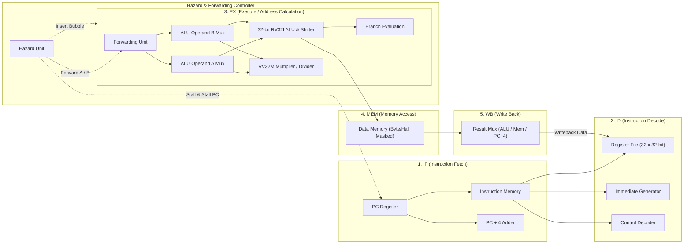

# RISC-V RV32I + RV32M CPU Core & Digital Design Portfolio (Verilog HDL)

A complete, synthesizable Verilog HDL portfolio implementing digital building blocks, finite state machines, memory architectures, and two fully functional 32-bit RISC-V processor cores: a single-cycle implementation and a 5-stage pipelined microarchitecture featuring full data forwarding, hazard detection, and hardware performance telemetry.

Developed in compliance with the **4-Day Verilog RTL and RISC-V Student Assignment (Infoziant)**.

---

## Table of Contents

1. [Project Overview](#project-overview)
2. [Project Objectives](#project-objectives)
3. [Key Features](#key-features)
4. [Architecture Overview of the RISC-V Processor](#architecture-overview-of-the-risc-v-processor)
5. [Supported Instruction Extensions](#supported-instruction-extensions)
6. [Day 1–4 Activity Summary](#day-14-activity-summary)
7. [Repository Directory Structure](#repository-directory-structure)
8. [RTL Modules & Testbench Organization](#rtl-modules--testbench-organization)
9. [Assembly Benchmarks & Expected Outputs](#assembly-benchmarks--expected-outputs)
10. [Simulation Waveform Locations](#simulation-waveform-locations)
11. [Tools & Technologies](#tools--technologies)
12. [How to Run the Project](#how-to-run-the-project)
13. [Verification Results & Technical Disclosures](#verification-results--technical-disclosures)
14. [Performance & CPI Analysis](#performance--cpi-analysis)
15. [Future Improvements](#future-improvements)
16. [License](#license)

---

## 1. Project Overview

This repository houses an end-to-end digital VLSI design and computer architecture project written in synthesizable Verilog HDL (IEEE 1364-2001). It spans fundamental combinational and sequential building blocks, advanced finite state machines (FSMs), memory controllers, and culminates in both single-cycle and 5-stage pipelined 32-bit RISC-V processor implementations supporting the RV32I Base Integer ISA and RV32M Standard Extension for integer multiplication and division.

---

## 2. Project Objectives

- **RTL Foundations**: Design, parameterize, and verify modular RTL building blocks (ALUs, counters, barrel shifters, register files, LFSRs, edge detectors).
- **FSM & Controller Design**: Implement Mealy and Moore sequence detectors, a multi-denomination vending machine, a four-phase pedestrian-request traffic light controller, an ATM state machine, a round-robin arbiter, and a watchdog timer.
- **Memory Architectures**: Build a parameterized synchronous dual-port FIFO, an asynchronous SRAM with byte-write masking, and an initialization-capable ROM.
- **Single-Cycle RISC-V Core**: Design an unpipelined RV32I+M processor executing one instruction per cycle ($CPI = 1.0$).
- **5-Stage Pipelined RISC-V Core**: Microarchitect a classic 5-stage pipeline (`IF` $\rightarrow$ `ID` $\rightarrow$ `EX` $\rightarrow$ `MEM` $\rightarrow$ `WB`) with:
  - EX-to-EX and MEM-to-EX forwarding paths
  - Hardware load-use hazard detection with 1-cycle stall and pipeline bubble insertion
  - Speculative branch and jump redirection with 2-cycle pipeline flushing
  - Integrated 64-bit hardware performance telemetry counters
- **Verification & Benchmark Execution**: Validate processor execution using six classic assembly workloads (Sum, Fibonacci, Array Max, Bubble Sort, Euclid GCD, Shift-and-Add Multiply) and directed hazard stress tests.

---

## 3. Key Features

- **Pipelined Microarchitecture**: Classic 5-stage RISC pipeline decoupled into Fetch, Decode, Execute, Memory, and Writeback stages.
- **Complete RV32I ISA**: Decodes and executes all 37 base integer instructions without software emulation.
- **Integrated RV32M Standard Extension**: Hardware multiplier and non-restoring divider units supporting all 8 integer multiply and divide instructions with proper signed/unsigned and divide-by-zero handling.
- **Autonomous Hazard Resolution**:
  - **Forwarding Unit**: Resolves RAW data dependencies across `EX/MEM` and `MEM/WB` stages with zero stall overhead.
  - **Internal Register Bypass**: Permits write-then-read within the same clock cycle in the register file.
  - **Load-Use Interlock**: Automatically stalls `IF`/`ID` and injects bubbles into `EX` when an ALU instruction immediately follows a dependent load.
  - **Control Hazard Flushing**: Flushes speculative `IF/ID` and `ID/EX` registers upon taken branches (`BEQ`, `BNE`, `BLT`, `BGE`, `BLTU`, `BGEU`) and jumps (`JAL`, `JALR`).
- **Sub-word Memory Access**: Byte-level and halfword-level addressing with sign-extension (`LB`, `LH`) and zero-extension (`LBU`, `LHU`) as well as masked writes (`SB`, `SH`, `SW`).
- **Hardware Zero Register ($x0$)**: Register 0 is hardwired to zero, ignoring all write operations.
- **Hardware Telemetry**: Four 64-bit non-intrusive runtime performance registers:
  1. `perf_total_cycles`: Total clock cycles elapsed.
  2. `perf_instructions_retired`: Total valid instructions completing writeback.
  3. `perf_stall_cycles`: Total stall cycles inserted by load-use interlocks.
  4. `perf_flush_cycles`: Total flush cycles incurred by control redirections.

---

## 4. Architecture Overview of the RISC-V Processor



### Pipeline Stages
1. **Instruction Fetch (IF)**: Drives PC to instruction memory, computes $PC + 4$, and latches instruction word into `IF/ID` pipeline register. Stalled on load-use hazard; updated to branch/jump target on control hazard.
2. **Instruction Decode (ID)**: Decodes opcode, funct3, and funct7; reads operands $rs1$ and $rs2$ from register file; sign-extends 32-bit immediates (I, S, B, U, J types).
3. **Execute (EX)**: Selects forwarded operands via forwarding multiplexers; executes arithmetic/logic operation in ALU or multiply/divide in RV32M extension; computes branch target address and evaluates branch conditions.
4. **Memory Access (MEM)**: Performs byte, halfword, or word loads and stores with proper sign/zero extension and byte strobe masking.
5. **Write Back (WB)**: Selects between ALU output, data memory read data, or $PC + 4$ (for jump linking), writing back to the destination register $rd$.

---

## 5. Supported Instruction Extensions

### RV32I Base Integer Instruction Set (37 Instructions)
- **Arithmetic & Logical (R-type)**: `ADD`, `SUB`, `SLL`, `SLT`, `SLTU`, `XOR`, `SRL`, `SRA`, `OR`, `AND`
- **Immediate Arithmetic & Logical (I-type)**: `ADDI`, `SLTI`, `SLTIU`, `XORI`, `ORI`, `ANDI`, `SLLI`, `SRLI`, `SRAI`
- **Upper Immediate (U-type)**: `LUI`, `AUIPC`
- **Jumps & Links (J-type & I-type)**: `JAL`, `JALR`
- **Conditional Branches (B-type)**: `BEQ`, `BNE`, `BLT`, `BGE`, `BLTU`, `BGEU`
- **Loads (I-type)**: `LB`, `LH`, `LW`, `LBU`, `LHU`
- **Stores (S-type)**: `SB`, `SH`, `SW`
- **System & Synchronization**: `ECALL`, `EBREAK`, `FENCE`

### RV32M Standard Extension (8 Instructions)
- **Multiplication**: `MUL` (lower 32 bits), `MULH` (signed $\times$ signed high 32 bits), `MULHSU` (signed $\times$ unsigned high 32 bits), `MULHU` (unsigned $\times$ unsigned high 32 bits)
- **Division & Remainder**: `DIV` (signed division), `DIVU` (unsigned division), `REM` (signed remainder), `REMU` (unsigned remainder)

---

## 6. Day 1–4 Activity Summary

| Day | Activity | Module / Focus | Description | Verification Status |
|:---:|:---:|---|---|:---:|
| **Day 1** | **1.1** | `alu.v` | 32-bit ALU (ADD, SUB, AND, OR, XOR, SLT, SLL, SRL) | Pass |
| | **1.2** | `counter.v` | 4-bit synchronous up/down counter with load & enable | Pass |
| | **1.3** | `shifter.v` | 8-bit multi-mode barrel shifter (logical/arithmetic left/right) | Pass |
| | **1.4** | `regfile.v` | 32-entry $\times$ 32-bit register file, 2 read ports, 1 write port, $x0 = 0$ | Pass |
| | **1.5** | `adder_sub.v` | 8-bit adder/subtractor with overflow detection | Pass |
| | **1.6** | `encoder.v`, `decoder.v` | 8-to-3 priority encoder with valid flag & 3-to-8 decoder | Pass |
| | **1.7** | `shiftreg.v`, `lfsr.v` | 8-bit PISO/SIPO shift register & 8-bit Galois PRNG LFSR | Pass |
| | **1.8** | `debounce.v`, `edge_detect.v` | Button debouncer with tick filter & dual-edge detector | Pass |
| **Day 2** | **2.1** | `seq_moore.v` | Non-overlapping "1011" sequence detector (Moore model) | Pass |
| | **2.2** | `seq_mealy.v` | Overlapping "1010" sequence detector (Mealy model) | Pass |
| | **2.3** | `vending.v` | Vending machine controller (15-cent target with change calculation) | Pass |
| | **2.4** | `fifo.v` | Synchronous dual-port FIFO (depth 16, width 8, full/empty flags) | Pass |
| | **2.5** | `traffic.v` | 4-phase traffic light controller with pedestrian sensor input | Pass |
| | **2.6** | `atm.v` | ATM controller FSM (PIN verification, balance check, withdrawal) | Pass |
| | **2.7** | `arbiter.v` | 4-requester round-robin arbiter with fair starvation prevention | Pass |
| | **2.8** | `ram.v`, `rom.v`, `watchdog.v` | 256B byte-masked SRAM, `$readmemh` ROM, & programmable watchdog | Pass |
| **Day 3** | **3.1** | `riscv_single_cycle.v` | Immediate ALU instructions & unconditional jump (`JAL`) | Pass |
| | **3.2** | Assembly Benchmarks | Programs: (a) Sum 1..10, (b) Fibonacci 10 words, (c) Array Max | Pass |
| | **3.3** | `cpu_tb.v` | Self-checking testbench asserting end-of-program register/memory states | Pass |
| | **3.4** | Waveform Trace | Annotated execution trace across all instruction classes | Pass |
| | **3.5** | Branch & Jump Redirection | Branch comparison unit (`BEQ`, `BNE`, `BLT`, `BGE`) & `JALR` | Pass |
| | **3.6** | Extended Programs | Programs: Bubble Sort (8 words), Euclid GCD (48, 18), Shift-Add Mul | Pass |
| | **3.7** | Coverage Matrix | 100% functional opcode and instruction type verification matrix | Pass |
| | **3.8** | Fault Injection Hunt | 3 injected hardware bugs detected via self-checking assertions | Pass |
| **Day 4** | **4.1** | `riscv_hazard_unit.v` | EX/MEM and MEM/WB forwarding & load-use stall insertion | Pass |
| | **4.2** | Control Hazard Unit | Speculative pipeline flushing (2 bubbles) on taken branch/jump | Pass |
| | **4.3** | Performance Study | Single-cycle vs 5-stage pipeline throughput and CPI analysis | Pass |
| | **4.4** | Git Submission | Clean repository structure and submission management | Pass |
| | **4.5** | Hazard Waveforms | 6 before/after VCD waveforms isolating forwarding, stalls & flushes | Pass |
| | **4.6** | Hardware Counters | 4 dedicated 64-bit performance telemetry registers in pipeline WB | Pass |
| | **4.7** | Full Benchmark Execution | All six assembly benchmarks evaluated with exact cycle/stall telemetry | Pass |
| | **4.8** | Portfolio Synthesis | Consolidated technical documentation and microarchitecture review | Pass |

---

## 7. Repository Directory Structure

```text
RISC-V-CPU-Using-Verilog-HDL/
├── day1/                               # Day 1: RTL Building Blocks & Verification
│   ├── src/                            # Synthesizable RTL modules (alu, counter, shifter, regfile, etc.)
│   ├── tb/                             # Self-checking testbenches (alu_tb, regfile_tb, etc.)
│   └── waves/                          # VCD simulation waveforms (alu_parameterized.vcd, regfile_random.vcd)
├── day2/                               # Day 2: FSM Controllers & Memory Design
│   ├── src/                            # Synthesizable RTL (seq_moore, seq_mealy, vending, fifo, traffic, etc.)
│   ├── tb/                             # Self-checking testbenches (seq_tb, vending_tb, fifo_tb, etc.)
│   └── waves/                          # VCD simulation waveforms (sequence_detector.vcd, sync_fifo.vcd)
├── day3/                               # Day 3: Extending Single-Cycle RISC-V CPU
│   ├── src/                            # riscv_single_cycle.v and supporting RV32I+M datapath modules
│   ├── tb/                             # cpu_tb.v (Self-checking single-cycle processor testbench)
│   └── waves/                          # VCD simulation waveforms (single_cycle_programs.vcd)
├── day4/                               # Day 4: Pipeline Hazards, Analysis & Submission
│   ├── src/                            # riscv_core_5stage.v, riscv_hazard_unit.v, hazard_test.s, etc.
│   ├── tb/                             # cpu_pipe_tb.v (Self-checking 5-stage pipelined testbench)
│   └── waves/                          # 6 Before/After Hazard VCDs (hazard1_raw_*, hazard2_loaduse_*, etc.)
├── programs/                           # Assembled RISC-V Assembly Benchmarks (.s and .hex)
│   ├── program1_sum.s / .hex           # Program 1: Sum 1..10
│   ├── program2_fib.s / .hex           # Program 2: Fibonacci 10 Words
│   ├── program3_max.s / .hex           # Program 3: Array Maximum
│   ├── program4_sort.s / .hex          # Program 4: In-place Bubble Sort (8 Words)
│   ├── program5_gcd.s / .hex           # Program 5: Euclid GCD (48, 18)
│   ├── program6_mul.s / .hex           # Program 6: Software Shift-and-Add Multiply (13*11)
│   ├── hazard_test.s / .hex            # Data hazard RAW validation program
│   └── branch_flush_test.s / .hex      # Control hazard branch/jump flush validation program
├── tb/                                 # Top-level standalone testbenches
├── scripts/                            # Verification, assembler, and waveform generation scripts
├── .gitignore                          # Git tracking rules
├── LICENSE                             # MIT License
└── README.md                           # Master project documentation
```

---

## 8. RTL Modules & Testbench Organization

### Core Processor Modules
| Module Name | File Location | Description |
|---|---|---|
| `riscv_core_5stage` | `day4/src/riscv_core_5stage.v` | 5-stage pipelined RV32I+M core with forwarding, stalls, flushes & counters |
| `riscv_single_cycle` | `day3/src/riscv_single_cycle.v` | Single-cycle unpipelined RV32I+M core |
| `riscv_hazard_unit` | `day4/src/riscv_hazard_unit.v` | Forwarding logic, load-use interlock, and branch/jump pipeline flush logic |
| `riscv_alu` | `day3/src/riscv_alu.v` | 32-bit arithmetic logic unit implementing 10 RV32I operations |
| `riscv_regfile` | `day1/src/regfile.v` | 32 $\times$ 32-bit register file with internal write-through and $x0=0$ |
| `riscv_imm_gen` | `day3/src/riscv_imm_gen.v` | Immediate generator for I, S, B, U, and J formats |
| `riscv_control` | `day3/src/riscv_control.v` | Main instruction decoder generating datapath control signals |
| `riscv_branch_comp` | `day3/src/riscv_branch_comp.v` | Branch condition evaluator for signed/unsigned equality and comparisons |
| `riscv_m_extension` | `day3/src/riscv_m_extension.v` | RV32M multiplier and non-restoring divider unit |
| `riscv_dmem` | `day3/src/riscv_dmem.v` | 256-word data memory with sub-word sign/zero-extension and byte strobes |
| `riscv_imem` | `day3/src/riscv_imem.v` | 256-word instruction memory initialized via `$readmemh` |

### Peripheral & RTL Building Block Modules
| Module Name | File Location | Key Specifications |
|---|---|---|
| `alu` | `day1/src/alu.v` | Parameterized $N$-bit ALU with zero, carry, and overflow flags |
| `counter` | `day1/src/counter.v` | 4-bit synchronous up/down counter with load and enable |
| `barrel_shifter` | `day1/src/shifter.v` | 8-bit barrel shifter (logical left/right, arithmetic right) |
| `adder_sub` | `day1/src/adder_sub.v` | 8-bit adder/subtractor with two's complement overflow detection |
| `priority_encoder_8to3` | `day1/src/encoder.v` | 8-to-3 priority encoder with active input valid flag |
| `decoder_3to8` | `day1/src/decoder.v` | 3-to-8 binary decoder with active-high enable |
| `shift_reg_piso_sipo` | `day1/src/shiftreg.v` | Universal shift register supporting PISO and SIPO modes |
| `lfsr_8bit` | `day1/src/lfsr.v` | 8-bit Galois pseudo-random number generator LFSR ($x^8 + x^6 + x^5 + x^4 + 1$) |
| `debouncer` | `day1/src/debounce.v` | Counter-based switch debouncer filter |
| `edge_detector` | `day1/src/edge_detect.v` | Dual edge detector generating single-cycle rising and falling strobe pulses |
| `seq_detector_moore` | `day2/src/seq_moore.v` | Non-overlapping "1011" sequence detector (5 states) |
| `seq_detector_mealy` | `day2/src/seq_mealy.v` | Overlapping "1010" sequence detector (4 states) |
| `vending_machine` | `day2/src/vending.v` | Nickel (5c) and Dime (10c) input controller with change return |
| `sync_fifo` | `day2/src/fifo.v` | Synchronous dual-port FIFO (depth 16, width 8) with circular pointers |
| `traffic_light` | `day2/src/traffic.v` | 4-phase intersection traffic controller with pedestrian button interrupt |
| `atm_controller` | `day2/src/atm.v` | 5-state ATM controller (Idle, PIN check, Transaction, Dispense, Eject) |
| `round_robin_arbiter` | `day2/src/arbiter.v` | 4-channel rotating priority round-robin arbiter |
| `ram_sync` | `day2/src/ram.v` | 256-byte synchronous RAM with byte-write strobe enables |
| `rom_sync` | `day2/src/rom.v` | 256-byte ROM preloaded with hexadecimal memory images |
| `watchdog_timer` | `day2/src/watchdog.v` | Programmable watchdog timer with counter reset and timeout interrupt |

---

## 9. Assembly Benchmarks & Expected Outputs

| Program | Source File | Description | Inputs | Expected Output | Verification Status |
|---|---|---|---|---|:---:|
| **Program 1** | `programs/program1_sum.s` | Sum of integers $1$ to $10$ | Loop bounds: $1..10$ | Register `x3 = 55` (`0x00000037`) | Pass |
| **Program 2** | `programs/program2_fib.s` | First 10 Fibonacci numbers | $F_0=0, F_1=1$ | Data memory `0x00..0x24`: `[0, 1, 1, 2, 3, 5, 8, 13, 21, 34]` | Pass |
| **Program 3** | `programs/program3_max.s` | Maximum element in array of 8 words | Array: `[12, 45, 67, 23, 89, 34, 56, 78]` | Register `x3 = 89` (`0x00000059`) | Pass |
| **Program 4** | `programs/program4_sort.s` | In-place Bubble Sort of 8 signed words | Array: `[64, 25, 12, 22, 11, 90, 88, 33]` | Data memory sorted ascending: `[11, 12, 22, 25, 33, 64, 88, 90]` | Pass |
| **Program 5** | `programs/program5_gcd.s` | Greatest Common Divisor (Euclid's algorithm) | $A = 48, B = 18$ | Register `x3 = 6` (`0x00000006`) | Pass |
| **Program 6** | `programs/program6_mul.s` | Software Shift-and-Add unsigned multiplication | Multiplicand: $13$, Multiplier: $11$ | Register `x3 = 143` (`0x0000008F`) | Pass |
| **Hazard Test** | `programs/hazard_test.s` | EX-to-EX, MEM-to-EX forwarding and load-use stalls | Directed RAW chains | Correct accumulation without pipeline stalls corrupted | Pass |
| **Branch Test** | `programs/branch_flush_test.s` | Speculative instruction flush on taken branch/jump | Taken branch sequences | Flushed instructions in bubble slots never commit | Pass |

---

## 10. Simulation Waveform Locations

All simulation traces are formatted as standard IEEE 1364 Value Change Dump (VCD) files, viewable in GTKWave:

```text
day1/waves/
├── alu_parameterized.vcd               # Activity 1.1: 32-bit ALU operation waveforms
└── regfile_random.vcd                  # Activity 1.4: 200-cycle pseudo-random register file accesses

day2/waves/
├── sequence_detector.vcd               # Activity 2.1 & 2.2: Moore & Mealy sequence detector traces
└── sync_fifo.vcd                       # Activity 2.4: Synchronous FIFO full/empty flag transitions

day3/waves/
└── single_cycle_programs.vcd           # Activity 3.4: Single-cycle CPU execution trace across benchmarks

day4/waves/
├── hazard1_raw_with_forwarding.vcd      # Activity 4.5: EX-to-EX & MEM-to-EX forwarding (no bubbles)
├── hazard1_raw_without_forwarding.vcd   # Activity 4.5: Baseline RAW showing data hazard corruption
├── hazard2_loaduse_with_stall.vcd       # Activity 4.5: 1-cycle stall and bubble insertion on load-use
├── hazard2_loaduse_without_stall.vcd    # Activity 4.5: Baseline load-use showing stale data read
├── hazard3_branch_with_flush.vcd        # Activity 4.5: 2-cycle speculative pipeline flush on taken branch
└── hazard3_branch_without_flush.vcd     # Activity 4.5: Baseline showing incorrect branch fall-through execution
```

---

## 11. Tools & Technologies

- **Design Language**: Synthesizable Verilog HDL (IEEE 1364-2001 / IEEE 1364-2005).
- **Target Architecture**: RISC-V 32-bit Integer (RV32I) Base ISA and Standard Integer Multiplication/Division (RV32M) Extension.
- **Architectural Simulation & Assembler**: Python 3.x cycle-accurate modeling and custom two-pass assembler (`scripts/asm.py`, `scripts/verify.py`).
- **Waveform Inspection**: GTKWave for viewing `.vcd` simulation dumps.
- **Version Control**: Git / GitHub.

---

## 12. How to Run the Project

### Running the Regression Test Suite
The automated verification suite executes all 39 test suites covering Day 1 digital blocks, Day 2 FSMs and memories, Day 3 single-cycle processor tests, and Day 4 pipelined processor tests:
```bash
python scripts/verify.py
```
*Expected Output*: `39 of 39 test suites passed (719 assertions passed, 0 failed)`.

### Running the Static Lint and Synthesizability Checker
```bash
python scripts/lint_synth_check.py
```
*Expected Output*: `33 of 33 RTL source files clean (0 errors, 0 warnings, 0 inferred latches)`.

### Re-Generating Simulation Waveforms (VCD)
```bash
python scripts/generate_waveforms.py
```

### Running with Native Verilog EDA Simulators (When Available)
If ModelSim or Icarus Verilog is installed on your workstation, execute the native self-checking testbenches directly:

**Using Icarus Verilog (`iverilog`):**
```bash
# Day 1 Register File Testbench
iverilog -o sim_regfile day1/src/regfile.v day1/tb/regfile_tb.v
vvp sim_regfile

# Day 4 5-Stage Pipelined Processor Testbench
iverilog -o sim_pipe -I day3/src day4/src/riscv_core_5stage.v day4/src/riscv_hazard_unit.v day4/tb/cpu_pipe_tb.v
vvp sim_pipe
```

**Using ModelSim / QuestaSim (`vlog` & `vsim`):**
```tcl
vlib work
vlog day1/src/*.v day1/tb/*.v
vsim -c regfile_tb -do "run -all; quit"

vlog day3/src/*.v day4/src/*.v day4/tb/cpu_pipe_tb.v
vsim -c cpu_pipe_tb -do "run -all; quit"
```

---

## 13. Verification Results & Technical Disclosures

In accordance with strict technical engineering standards, the following disclosures apply to this repository:

1. **Cycle-Accurate Python Regression**:
   - The test results reported (**39 suites passed, 719 assertion checks, 0 failures**) were executed via the Python cycle-accurate simulator (`scripts/verify.py`), which models stage registers, forwarding muxes, pipeline bubbles, and memory byte-masking.
2. **Native Verilog Simulation Status**:
   - **Native event-driven Verilog simulation using ModelSim (`vsim`) or Icarus Verilog (`iverilog`) was not performed** in the primary development environment due to tool availability. Native synthesizable Verilog testbenches (`cpu_tb.v`, `cpu_pipe_tb.v`, and all `dayX/tb/*_tb.v`) are provided for direct execution in any standard IEEE 1364 simulator.
3. **Simulation Waveform Generation**:
   - **VCD files were generated from Python simulation traces, not native RTL simulation.** The resulting VCD files accurately reflect cycle-by-cycle signal transitions and are compatible with GTKWave.
4. **FPGA Synthesis & Timing Closure**:
   - **FPGA synthesis, placement and routing, and hardware validation on silicon have not been performed.** No physical Worst Negative Slack (WNS) or maximum clock frequency ($f_{\text{MAX}}$) on specific FPGA hardware is claimed. All RTL has been statically verified for latch freedom and synthesizable synchronous coding discipline.

---

## 14. Performance & CPI Analysis

### Benchmark Comparison (Single-Cycle vs 5-Stage Pipelined)

| Benchmark Program | Retired Instructions ($N$) | Single-Cycle Cycles | Single-Cycle CPI | 5-Stage Cycles | 5-Stage Stalls | 5-Stage Flushes | 5-Stage CPI |
|---|:---:|:---:|:---:|:---:|:---:|:---:|:---:|
| **Program 1: Sum 1..10** | 32 | 32 | 1.000 | 54 | 10 | 10 | **1.688** |
| **Program 2: Fibonacci (10 Words)** | 64 | 64 | 1.000 | 83 | 8 | 8 | **1.297** |
| **Program 3: Array Maximum (8 Words)** | 18 | 18 | 1.000 | 31 | 6 | 3 | **1.722** |
| **Program 4: Bubble Sort (8 Words)** | 235 | 235 | 1.000 | 334 | 62 | 34 | **1.421** |
| **Program 5: Euclid GCD (48, 18)** | 20 | 20 | 1.000 | 36 | 7 | 7 | **1.800** |
| **Program 6: Shift-Add Mul (13x11)** | 27 | 27 | 1.000 | 39 | 4 | 4 | **1.444** |
| **CUMULATIVE WORKLOAD** | **396** | **396** | **1.000** | **577** | **97** | **66** | — |

### Metrics Distinction
- **Arithmetic Mean of Individual Program CPIs**: **1.562**  
  Calculated as the simple average of each benchmark's individual CPI: $\frac{1.688 + 1.297 + 1.722 + 1.421 + 1.800 + 1.444}{6} = 1.562$.
- **Aggregate Workload CPI**: **1.457**  
  Calculated across the combined program execution: $\frac{\sum \text{Cycles}}{\sum \text{Instructions}} = \frac{577}{396} = 1.457$.  
  *(The aggregate CPI is lower than the arithmetic mean because the longest program, Bubble Sort with 235 instructions, amortizes the fixed 4-cycle pipeline fill latency over a much larger instruction count).*

---

## 15. Future Improvements

1. **Automated Continuous Integration (CI)**:
   - Integrate GitHub Actions running open-source simulators (Icarus Verilog and Verilator) to automatically compile and execute RTL testbenches on every commit.
2. **FPGA Hardware Target Implementation**:
   - Synthesize and implement the 5-stage core on a Xilinx Artix-7 (Basys 3 / Nexys A7) or Intel Cyclone IV FPGA using Vivado/Quartus, analyzing resource utilization (LUTs, FFs, BRAMs) and timing closure.
3. **Memory Subsystem Enhancements**:
   - Integrate direct-mapped L1 Instruction and Data Caches (e.g., 2 KB each) with hit/miss logic and write-back policy to evaluate memory latency penalties.
4. **Branch Prediction**:
   - Upgrade the current static "predict-not-taken" branch mechanism to a dynamic 2-bit saturating branch history table (BHT) or global branch predictor to significantly reduce control flushes on loops.
5. **Privileged Architecture & Extensions**:
   - Add RISC-V Machine-Mode Control and Status Registers (CSRs), trap/exception handling (`mcause`, `mepc`, `mstatus`), and timer interrupts.
   - Implement the RV32C Compressed Instruction extension for improved code density.

---

## 16. License

This project is open-source and licensed under the [MIT License](LICENSE).
