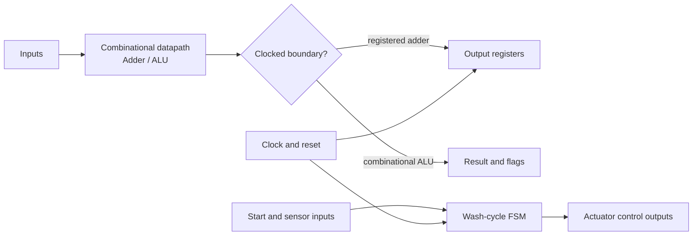
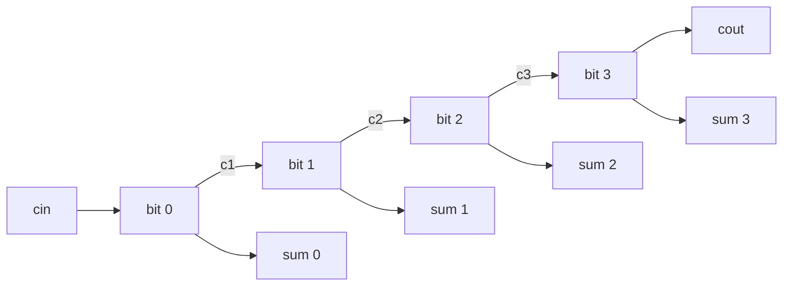
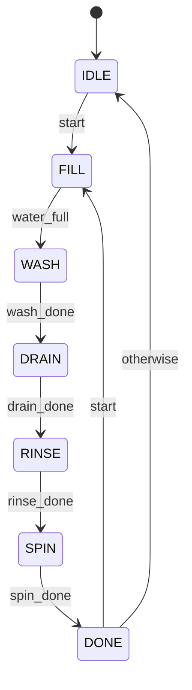

# Verilog Digital Design Portfolio

A hands-on Verilog portfolio exploring combinational arithmetic, sequential logic, a small ALU, and finite-state-machine control. The modules and explanations in this repository are written as a standalone learning project, with concepts informed by a review of the downloaded training examples documented in [the source review](docs/source-review.md).

## Projects

| Design | What it demonstrates | RTL |
|---|---|---|
| 4-bit ripple-carry adder | Full-adder equations and carry propagation | [`rtl/ripple_adder_4bit.v`](rtl/ripple_adder_4bit.v) |
| Registered adder | Clocked output, synchronous reset, one-cycle capture | [`rtl/registered_adder_4bit.v`](rtl/registered_adder_4bit.v) |
| 4-bit ALU | Add, subtract, AND, OR, XOR, flags, default behavior | [`rtl/alu_4bit.v`](rtl/alu_4bit.v) |
| Wash-cycle controller | Moore FSM, sensor handshakes, safe output defaults | [`rtl/wash_controller.v`](rtl/wash_controller.v) |

## Design flow



## Ripple-carry adder

Each bit computes `sum = A ^ B ^ carry_in`; the carry-out is `(A & B) | (A & carry_in) | (B & carry_in)`. The carry from bit *i* feeds bit *i+1*. The 5-bit conceptual result is `{cout, sum}`.



## ALU operation codes

| `opcode` | Operation | `carry_borrow` meaning |
|---|---|---|
| `000` | `A + B` | Carry out |
| `001` | `A - B` | Borrow (`A < B`) |
| `010` | `A & B` | Always 0 |
| `011` | `A \| B` | Always 0 |
| `100` | `A ^ B` | Always 0 |
| Other | Result defaults to 0 | 0 |

The zero flag is asserted whenever the 4-bit result is zero. Arithmetic wraps to four result bits; the add carry and subtract borrow remain separately visible.

## Wash-cycle FSM



This is a Moore-style controller: actuator outputs depend on the current state. Inputs are assumed to be synchronous to `clk`; synchronize external asynchronous sensor signals before using this controller in hardware.

## Simulation

The self-checking testbenches are under `tb/`. With Icarus Verilog installed, run from the repository root:

```sh
iverilog -g2012 -s tb_ripple_adder_4bit -o work_adder rtl/ripple_adder_4bit.v tb/tb_ripple_adder_4bit.v
vvp work_adder
iverilog -g2012 -s tb_alu_4bit -o work_alu rtl/alu_4bit.v tb/tb_alu_4bit.v
vvp work_alu
iverilog -g2012 -s tb_registered_adder_4bit -o work_reg rtl/ripple_adder_4bit.v rtl/registered_adder_4bit.v tb/tb_registered_adder_4bit.v
vvp work_reg
iverilog -g2012 -s tb_wash_controller -o work_fsm rtl/wash_controller.v tb/tb_wash_controller.v
vvp work_fsm
```

The adder testbench exhausts all 512 input combinations. The ALU bench checks all supported operation classes and flags. The sequential and FSM benches check reset, state progression, and representative transitions. These are provided for you to run; no simulator run is claimed in this repository yet.

## Repository map

```text
rtl/       Synthesizable design modules
 tb/       Self-checking simulation testbenches
docs/      Source review and design notes
```

## Scope and learning notes

This is a collection of independent digital-design exercises, not a CPU or a complete RISC-V implementation. The downloaded processor exercise uses a custom instruction encoding and should not be described as ISA-compliant RISC-V. See [docs/source-review.md](docs/source-review.md) for the folder-by-folder audit and the design decisions made from it.

## License

MIT. See [LICENSE](LICENSE).
