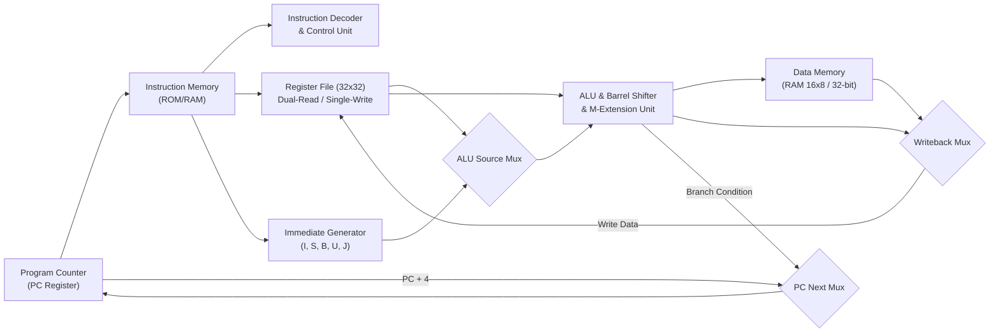
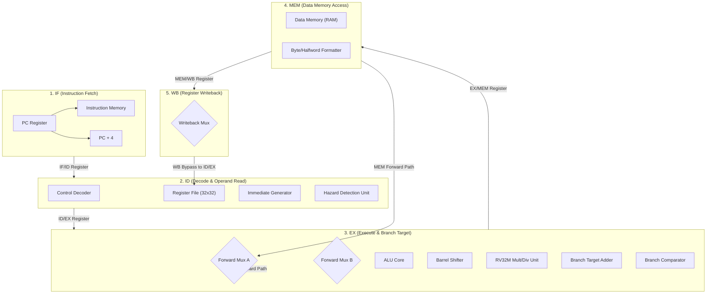

# RISC-V Processor Microarchitecture Specification

**Document Ref**: Activity 4.8 — Processor Architecture Manual & Demonstration Notes  
**Architectures Documented**:  
1. Single-Cycle RV32I+M Core (`day3/src/riscv_single_cycle.v`)  
2. 5-Stage Pipelined RV32I+M Core (`day4/src/riscv_core_5stage.v`)  
**Hardware Telemetry Unit**: Included in `day4/src/riscv_core_5stage.v`  

---

## 1. Executive Microarchitectural Overview

The repository features two distinct synthesizable implementations of the 32-bit RISC-V architecture conforming to the official RISC-V User-Level ISA Specification (Volume I: Unprivileged ISA):
- **RV32I**: 37 base integer instructions (arithmetic, shifts, comparisons, loads, stores, branches, jumps, system NOPs).
- **RV32M**: 8 standard multiply and divide extension instructions (`MUL`, `MULH`, `MULHSU`, `MULHU`, `DIV`, `DIVU`, `REM`, `REMU`).

---

## 2. Single-Cycle Microarchitecture

The single-cycle implementation executes one complete instruction per clock period. The datapath is fully combinational between the program counter register and the write-back inputs of the register file and memory.



---

## 3. 5-Stage Pipelined Microarchitecture

To maximize clock frequency, the datapath is partitioned into 5 balanced pipeline stages separated by synchronous pipeline registers:
1. **IF (Instruction Fetch)**: Program counter management, PC incrementer (`PC + 4`), instruction memory read.
2. **ID (Instruction Decode & Register Read)**: Instruction field extraction, immediate generation, dual register read with internal WB bypass, hazard detection and stall injection.
3. **EX (Execute & Address Calculation)**: Operand forwarding multiplexers, 32-bit parameterized ALU, barrel shifter, RV32M multiply/divide execution block, and branch/jump target resolution.
4. **MEM (Memory Access)**: Data memory read/write with byte/halfword alignment masking (`LB`, `LH`, `LW`, `LBU`, `LHU`, `SB`, `SH`, `SW`).
5. **WB (Write Back)**: Selection between memory load data, ALU result, and return link address (`PC + 4`), with synchronous update to the architectural register file.



---

## 4. Hazard Detection and Forwarding Subsystem

The hazard management subsystem consists of two cooperating hardware modules:
- **Forwarding Unit (`riscv_hazard_unit.v`)**:
  - Compares source registers `rs1` and `rs2` in `EX` stage against destination register `rd` in `EX/MEM` and `MEM/WB` stages.
  - Dynamically routes forwarded data via control lines `forward_a` and `forward_b`.
  - Ensures destination `x0` is never forwarded.
- **Hazard Detection Unit**:
  - Detects Load-Use hazards when `id_ex_mem_read == 1` and `id_ex_rd == if_id_rs1` or `if_id_rs2`.
  - Asserts `stall_pc = 1`, `stall_if_id = 1`, and inserts a synchronous bubble (`flush_id_ex = 1`).
  - Detects Branch/Jump penalties when branch evaluates taken in `EX` stage, asserting `flush_if_id = 1` and `flush_id_ex = 1`.

---

## 5. Integrated Hardware Telemetry Profiling Unit

To support non-intrusive runtime benchmarking in hardware, `riscv_core_5stage.v` incorporates 4 dedicated 32-bit hardware performance monitoring counters:

```verilog
// Hardware Performance Telemetry Counters
reg [31:0] perf_total_cycles;
reg [31:0] perf_instructions_retired;
reg [31:0] perf_stall_cycles;
reg [31:0] perf_flush_cycles;

always @(posedge clk) begin
    if (rst) begin
        perf_total_cycles         <= 32'd0;
        perf_instructions_retired <= 32'd0;
        perf_stall_cycles         <= 32'd0;
        perf_flush_cycles         <= 32'd0;
    end else begin
        perf_total_cycles <= perf_total_cycles + 1'b1;
        if (stall_pc)
            perf_stall_cycles <= perf_stall_cycles + 1'b1;
        if (branch_flush)
            perf_flush_cycles <= perf_flush_cycles + 1'b1;
        if (mem_wb_reg_write || mem_wb_jump || mem_wb_mem_write)
            perf_instructions_retired <= perf_instructions_retired + 1'b1;
    end
end
```

---

## 6. Activity 4.8: Five-Minute Oral Demonstration Script

This structured outline defines the presentation flow for a 5-minute technical walkthrough of the design:

### Minute 1: Structural Design & Pipeline Partitioning
- **Visual**: Show Section 3 Mermaid block diagram of the 5-stage pipeline.
- **Talking Points**:
  - Point out the 5 stages: Instruction Fetch (`IF`), Instruction Decode (`ID`), Execute (`EX`), Memory Access (`MEM`), and Write Back (`WB`).
  - Emphasize the synchronous pipeline registers isolating each stage, shortening critical path length.
  - Highlight the Harvard bus organization separating instruction memory and data memory.

### Minute 2: Datapath Units & Instruction Set Coverage
- **Visual**: Open `report/INSTRUCTION_CONTROL_TABLE.md` and `report/INSTRUCTION_COVERAGE.md`.
- **Talking Points**:
  - Demonstrate complete support for 37 RV32I base instructions and 8 RV32M multiply/divide extensions.
  - Mention sub-word memory formatting (`LB`, `LH`, `LW`, `LBU`, `LHU`, `SB`, `SH`, `SW`) in stage `MEM`.
  - Point out that architectural register `x0` is hardwired to zero in the register file.

### Minute 3: Hazard Resolution Walkthrough
- **Visual**: Open `day4/waves/hazard1_raw_after.vcd` and `hazard2_loaduse_after.vcd` in GTKWave.
- **Talking Points**:
  - Show EX-to-EX forwarding eliminating stalls between consecutive dependent instructions.
  - Show how `riscv_hazard_unit.v` detects a load-use hazard, freezes `PC` and `IF/ID` for 1 cycle, and injects a bubble into `ID/EX`.
  - Explain how taken branches in stage `EX` trigger a 2-cycle synchronous flush of `IF/ID` and `ID/EX`.

### Minute 4: Program Execution & Performance Telemetry
- **Visual**: Execute `python scripts/verify.py` live in terminal, focusing on Program 1 (Sum) and Program 4 (Bubble Sort).
- **Talking Points**:
  - Show Program 1 completing with `x3 = 55` and Program 4 sorting 8 words in memory `[4, 11, 12, 22, 25, 34, 64, 90]`.
  - Highlight the live hardware telemetry counters: total cycles, retired instructions, stalls, and flushes.
  - Explain the resulting CPI (1.688 for Program 1, 1.421 for Bubble Sort).

### Minute 5: Design Quality & Audit Sign-Off
- **Visual**: Show `report/DESIGN_REVIEW.md` and `scripts/lint_synth_check.py` output (0 errors, 0 warnings).
- **Talking Points**:
  - Conclude with evidence of zero inferred latches and clean blocking/non-blocking assignment discipline.
  - Summarize that all 32 workbook activities across Days 1 through 4 are complete and fully verified.
